<h1 align="center">Привет, я kreker194 👋</h1>

<!-- Строки анимации: Claude Max 5x Senior Developer; на 20x не хватило; работает? не трогай;
     ещё один промпт, и точно заработает; ревьюю код, который не писал; коммит: fix fix final final2; git commit -m "czmcvinsgiunsg"
     Кириллица в ссылке закодирована. Новые строки удобно собрать тут: https://readme-typing-svg.demolab.com/demo/ -->

  

---

<!-- Змейку рисует .github/workflows/snake.yml в ветку output -->
<picture>
  <source media="(prefers-color-scheme: dark)" srcset="https://raw.githubusercontent.com/mxxnlght555/mxxnlght555/output/snake-dark.svg" />
  <source media="(prefers-color-scheme: light)" srcset="https://raw.githubusercontent.com/mxxnlght555/mxxnlght555/output/snake.svg" />
  
</picture>

### 🛠 Стек

моя команда разработки (я в ней джун)

### 🪫 Лимиты

### 📈 Статистика

---

собрано на остатках недельного лимита

